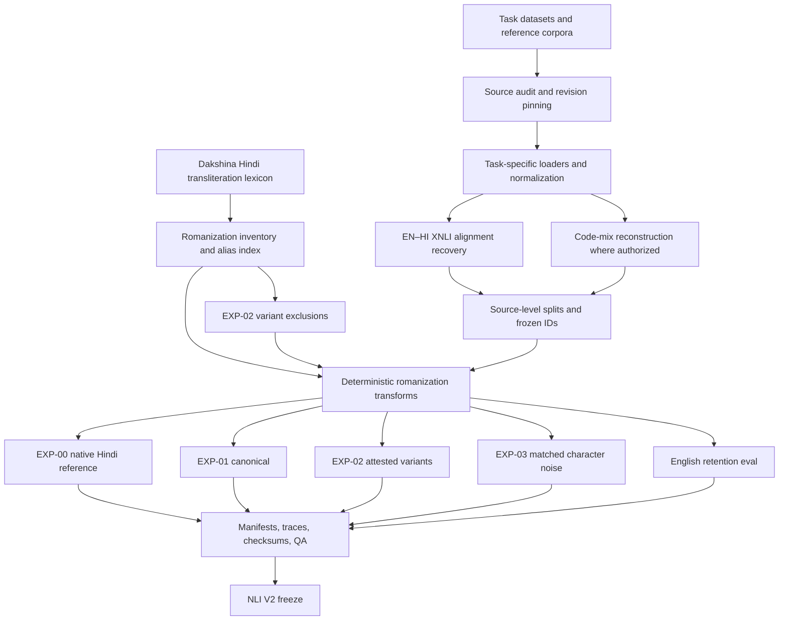

# RomCoM-Drift

**Romanized Code-Mixed Indic LLM Robustness**

A research codebase for studying how language models handle Hindi written in Latin script, including Hindi–English code-mixed settings. The central experimental question is whether **attested Romanized-Hindi spelling variation** is a better adaptation signal than **canonical romanization** or **matched non-linguistic character noise**.

This repository currently releases the **data layer**: source audit, provenance, romanization inventory, deterministic augmentation, split isolation, and a frozen Hindi NLI experiment package. **Fine-tuning has not started.** This README does not report model scores, adapters, or claims of improved robustness.

> **Release status.** Data preparation and romanization augmentation are implemented. The Hindi NLI V2 snapshot is frozen (`APPROVED_WITH_DOCUMENTED_CAVEATS`). Paraphrase and toxicity retain documented review gates. Model training, evaluation, and transfer experiments (Bengali, Gujarati, Tamil) have not been run.

---

## Contents

- [Why this exists](#why-this-exists)
- [Research question](#research-question)
- [What this release contains](#what-this-release-contains)
- [What this release does not contain](#what-this-release-does-not-contain)
- [Method overview](#method-overview)
- [Source data and task preparation](#1-source-data-and-task-preparation)
- [Code-mixing reconstruction](#2-code-mixing-reconstruction)
- [Romanization inventory](#3-romanization-inventory)
- [Augmentation conditions](#4-augmentation-conditions)
- [Frozen Hindi NLI package (V2)](#5-frozen-hindi-nli-package-v2)
- [Splits, provenance, and data QA](#6-splits-provenance-and-data-qa)
- [Data sources](#data-sources)
- [Limitations and open gates](#limitations-and-open-gates)
- [Repository layout](#repository-layout)
- [Setup](#setup)
- [Reproducing the data pipeline](#reproducing-the-data-pipeline)
- [Tests](#tests)
- [Model adaptation status](#model-adaptation-status)
- [Data use and licensing](#data-use-and-licensing)
- [Citation](#citation)
- [References](#references)

---

## Why this exists

Romanized Hindi has no single standardized spelling in everyday digital communication. The same Hindi word can appear in several Latin-script forms (`kshan` / `shan`, `yah` / `yeh`, `kabja` / `kabza`), while English tokens and Hindi–English switch points often occupy the same sentence. That is an **orthographic robustness** problem for Indic language models, distinct from native-script understanding and distinct from generic character noise.

Indi-RomCoM ([Das et al., 2026](https://arxiv.org/abs/2606.30790)) is the methodological reference for Romanized Indic–English instruction following. Its official training artifact was **not located** in this project's source audit. RomCoM-Drift therefore builds a **methodology-informed, auditable reconstruction** from underlying task sources, plus a separate **Hindi NLI romanization experiment** on conditionally approved IndicXNLI–XNLI pairs.

The two products are related but not interchangeable:

| Product | What it is | What it is not |
| --- | --- | --- |
| Phase 2 reconstruction pipeline | Deterministic, taxonomy-guided code-mixing over Hindi task sources, then canonical / attested-variant / matched-noise views | The official Indi-RomCoM training release |
| Frozen NLI V2 package | Romanized Hindi NLI (premise + hypothesis) with matched conditions, field-scope eval sets, and an English retention benchmark | Intra-sentential Hindi–English code-mixing; a trained model |

---

## Research question

**Does training with realistic Romanized-Hindi spelling variation improve a model's ability to process Hindi–English code-mixed and Romanized-Hindi text, compared with canonical romanization and non-linguistic character noise?**

The study is designed around Hindi–English examples. Bengali–English, Gujarati–English, and Tamil–English are held out for later transfer evaluation. Those model experiments have not been run.

A narrower, currently materialized question for the frozen NLI package is:

**Holding source IDs, labels, and splits fixed, does attested Dakshina spelling variation (EXP-02) differ from canonical romanization (EXP-01) and from distance-matched random noise (EXP-03) as a Hindi NLI training condition?**

No answer is claimed here. The data are prepared so that question can be asked without confounding split leakage, label drift, or unmatched token positions.

---

## What this release contains

Implemented and documented:

- Source discovery, revision pinning, schema inspection, and license evidence capture.
- Task-specific loaders and normalization for NLI, paraphrase, and toxicity/refusal data.
- Deterministic reconstruction of Hindi–English code-mixed examples where the official Indi-RomCoM training artifact was unavailable.
- A Hindi romanization inventory from the Dakshina training lexicon, with alias indexes, English-collision filters, and EXP-02 variant exclusions.
- Generation of canonical, attested-variation, and matched-noise conditions.
- Recovered English–Hindi XNLI alignment for a documented subset (`CONDITIONALLY_APPROVED`).
- Frozen Hindi NLI experiment package **V2** (`383,059` examples; owner verdict `APPROVED_WITH_DOCUMENTED_CAVEATS`).
- Source-aware splitting, stable example identifiers, checksums, per-example provenance, token-level traces, and data-quality reports.
- Unit tests for data contracts, split isolation, inventory filters, alignment, and augmentation invariants.

---

## What this release does not contain

- Fine-tuning runs, trained adapters, baselines, or downstream scores.
- A claim that attested variation improves robustness.
- The official Indi-RomCoM `395,076`-instance training release.
- A byte-for-byte reproduction of that corpus, or LLM-assisted generation as used in the paper.
- Fully cleared paraphrase code-mixed training data.
- Evidence of robustness to Romanized **user** toxicity prompts (toxicity transforms the assistant target only).
- Permission to redistribute upstream corpora or derived JSONL as a single licensed dataset.

---

## Method overview



Randomness is derived from a documented base seed (`42`) and per-example, per-field, per-condition salts so generated views can be reproduced and audited. Labels, example IDs, and split membership are invariant across conditions.

---

## 1. Source data and task preparation

The project uses task-labelled Hindi sources and reconstructs required bilingual or Romanized views only where the source schema supports it.

| Task | Intended capability | Structure preserved | Current data status |
| --- | --- | --- | --- |
| Natural language inference | Reason over a premise and hypothesis | Premise, hypothesis, source relation label | **Primary frozen package:** NLI V2 on conditionally approved EN–HI pairs |
| Paraphrase detection | Decide whether two sentences are equivalent | Both sentences and the original pair label | English-pivot code-mix **NO-GO**; Hindi-native path **CONDITIONAL_GO**, no EXP rebuild |
| Toxicity / refusal generation | Produce an appropriate response to harmful or benign prompts | User prompt, assistant response, source-derived class/provenance | Source freeze accepted; **target-side** romanization only; not input robustness |

Task records retain their task-specific fields rather than being flattened into a single text column. Original labels and source identifiers are preserved through normalization and augmentation.

The official Indi-RomCoM paper describes a larger fine-tuning corpus. The corresponding official training artifact was not located. The current data package is a methodology-informed reconstruction from underlying task sources, **not** the official training release.

---

## 2. Code-mixing reconstruction

Where reconstruction is required, the pipeline uses explicit deterministic rules informed by the published Indi-RomCoM task and code-mixing methodology (taxonomy categories and mixing intensities). Reconstruction is kept **separate** from the romanization-augmentation stage.

Romanization experiments change eligible Hindi spellings. They are not intended to invent new English–Hindi switch locations or alter original task labels.

Known deviations from the paper's generation procedure are documented in the data reports:

- Deterministic lexical and taxonomy rules replace the paper's reported LLM-assisted generation.
- CAT-E clause rewriting is approximated; it is not an LLM rewrite.
- Tokens without a lexicon entry are not silently forced into Hindi variants.

Reconstructed examples must not be described as official Indi-RomCoM benchmark examples.

---

## 3. Romanization inventory

The production inventory is built from the Hindi training lexicon in Google's Dakshina dataset, specifically `hi.translit.sampled.train.tsv`. Held-out Dakshina lexicon and sentence-romanization files are used for diagnostics only, not as training inventory.

Recomputed inventory (Phase 2 report):

| Quantity | Value |
| --- | ---: |
| Native words | 24,999 |
| Variant rows | 44,202 |
| Usable aliases | 38,682 |
| Ambiguous aliases | 2,563 |
| English-collision aliases | 99 |
| Canonical ties | 3,337 |
| Invalid source rows | 2 |

The inventory builder and alias index:

- Group observed Romanized variants by Devanagari source word.
- Retain original attestation counts for each word–variant pair.
- Identify canonical candidates using the highest-attestation variant, recording ties.
- Build a reverse Romanized-alias lookup for matching Latin-script tokens.
- Identify ambiguous aliases and aliases that collide with common English words so they can be excluded from automatic replacement.
- Preserve provenance from inventory entries back to the source lexicon.

NLI V2 additionally filters **68** audited `(native, variant)` mappings from EXP-02 selection pools (`wrong_word_substitution` or `garbled_spelling`). Five further mappings are **quarantined** (still selectable; flag in analysis). The Dakshina TSV itself is not edited; filtering is applied at pool-build time.

**Important.** Dakshina attestation counts are annotator counts in a transliteration dataset. They are **not** estimates of WhatsApp, social-media, or population-level typing frequencies. The inventory is a source of attested spelling alternatives, not a model of real-world spelling probability.

Matching is conservative. The pipeline does not use fuzzy matching or a language model to guess whether an arbitrary Latin token is Hindi. Out-of-vocabulary handling is explicit. On the frozen NLI V2 package, Dakshina dictionary coverage is **85.4%** of eligible native tokens; the remaining **14.6%** use a documented character-map fallback. Fallback must not silently turn English words or named entities into Hindi variants.

---

## 4. Augmentation conditions

Three matched training conditions are generated from the same underlying examples and split assignments. NLI V2 also materializes two **evaluation-only** references.

| Condition | Description | Purpose |
| --- | --- | --- |
| **EXP-00 — Native Hindi** | Unchanged Devanagari premise and hypothesis. Dev/test only; not a training condition. | Native-script reference. |
| **EXP-01 — Canonical** | Eligible Hindi tokens converted to a deterministic canonical Romanized form from Dakshina, with documented OOV fallback. | Consistent spelling condition. |
| **EXP-02 — Realistic variation** | Eligible tokens replaced with alternative attested Dakshina variants (`p_variant = 0.35`, attestation-weighted). | Orthographic variation grounded in the lexicon. |
| **EXP-03 — Matched noise** | Synthetic Latin-character perturbations at the **same** selected token positions, with Levenshtein distance matched to EXP-02. | Control for generic character corruption. |
| **English retention** | Aligned English premise and hypothesis. Dev/test only. | Untrained English baseline; **not** a code-mixed training condition. |

Configuration records the base seed (`42`), variant-selection probability, protected-token rules (URLs, emails, hashtags, handles, numbers, all-caps), inventory source, and Dakshina collision resampling for EXP-03.

Each generated training row retains the same example identity, task, label, and split as its source row. Token-level traces record which fields and tokens were eligible, what changed, which inventory entries were consulted, and why a token was left unchanged.

NLI evaluation additionally varies **field scope** on dev/test:

| Scope | Premise | Hypothesis | Splits |
| --- | --- | --- | --- |
| `both` | Romanized | Romanized | train / dev / test |
| `premise_only` | Romanized | Native Devanagari | dev / test |
| `hypothesis_only` | Native Devanagari | Romanized | dev / test |

Training uses `both` only.

---

## 5. Frozen Hindi NLI package (V2)

**Snapshot:** `romcomx_data/nli_experiments_v2/`
**Freeze date:** 2026-11-03
**Owner verdict:** `APPROVED_WITH_DOCUMENTED_CAVEATS`
**Freeze record:** [`romcomx_data/nli_experiments_v2_FREEZE_RECORD.md`](romcomx_data/nli_experiments_v2_FREEZE_RECORD.md)

This is the current training-candidate NLI artifact. Do not regenerate or overwrite it. Future changes must be a new version (for example V3).

### Alignment basis

A same-index join of current English XNLI sources onto IndicXNLI train yields only **34.4%** label agreement. That figure is a symptom of local order breaks in the historical English train file, **not** a pairing.

A later corroborated recovery (`corroborated_premise_translation_and_unique_label`) produced a documented subset that is **conditionally approved**:

| Split | Approved rows |
| --- | ---: |
| Train | 375,565 |
| Dev | 2,487 |
| Test | 5,007 |
| **Total** | **383,059** |

Withheld from the verified train file: identical-text rows with conflicting labels, degenerate repeated-token translations, unmatched/ambiguous premises, and sampled semantic failures. Questionable-but-matched translations remain in the approved subset and are listed in the alignment validation report. Alignment is **not** a proof that every Hindi sentence is a perfect semantic equivalent of its English counterpart.

### V1 → V2 correction

V1 initialized the EXP-02/EXP-03 RNG **inside** the per-token loop with the same field salt, producing field-level all-or-nothing selection (zero partial mixes) and identical EXP-03 edit-position sequences for same-length tokens in a field.

V2 initializes **one RNG per field** before iterating tokens. `BASE_SEED`, `p_variant`, distance matching, and attested-collision rejection are unchanged. EXP-00, EXP-01, and English retention are byte-identical to V1. EXP-02 and EXP-03 were rebuilt.

| Metric | V1 | V2 |
| --- | ---: | ---: |
| EXP-02 eligible tokens | 5,857,043 | 5,821,353 |
| EXP-02 selected tokens | 2,047,971 | 2,036,028 |
| Train fields with partial selection | 0 | 602,973 |
| Excluded-variant selections | ~13,869 | 0 |
| Empirical selection rate (train/dev/test) | — | 0.350 / 0.351 / 0.350 |
| EXP-02/EXP-03 matched alignment | — | **2,036,028 / 2,036,028** |

Post-freeze audit (2026-11-07): train/dev/test ID disjointness **PASS**; cross-condition ID and label consistency **PASS**; checksums **PASS**. Five quarantine mappings remain selectable (281 attested-variant hits in V2 logs; see the post-freeze audit).

Authoritative package documentation: [`romcomx_data/nli_experiments_v2/README.md`](romcomx_data/nli_experiments_v2/README.md).

---

## 6. Splits, provenance, and data QA

Data preparation is designed to prevent related examples or augmented views from leaking across splits.

The pipeline includes:

- Source-level or group-aware split assignment, using official train/validation/test boundaries where available and deterministic group splits otherwise (paraphrase uses connected components over both sentence columns).
- Stable `example_id` and source identifiers.
- Source revision and license references, source-row hashes, and SHA-256 checksums.
- Split manifests and row-level provenance.
- Matching checks across EXP-01, EXP-02, and EXP-03 for example IDs, labels, and split membership.
- Structural checks for task fields and label preservation.
- Token-level transformation traces and owner-review samples.
- Task audits for source schemas, inventory quality, split integrity, alignment recovery, and augmentation construction.

These checks validate **data construction**. They are not model evaluations. Automated checks do not establish that every generated spelling is natural or that every reconstructed example is semantically equivalent to its source.

---

## Data sources

| Source | Role in this project | Pin |
| --- | --- | --- |
| [IndicXNLI](https://huggingface.co/datasets/Divyanshu/indicxnli) | Hindi NLI source records and labels | `7092c278…` |
| [XNLI](https://github.com/facebookresearch/XNLI) / MultiNLI English | English-side alignment for the NLI package | recovered subset only |
| [IndicXParaphrase](https://huggingface.co/datasets/ai4bharat/IndicXParaphrase) | Hindi paraphrase source pairs and labels | `181031f9…` |
| [IndicAlign](https://huggingface.co/datasets/ai4bharat/indic-align) `Toxic_Matrix` | Toxicity/refusal source conversations; benign comparison from Dolly-derived sample | `032b6a90…` |
| [Dakshina](https://github.com/google-research-datasets/dakshina) | Hindi transliteration pairs for the romanization inventory | train lexicon only |
| [COMI-LINGUA](https://huggingface.co/datasets/LingoIITGN/COMI-LINGUA) | Supplementary reference for Hindi–English code-mixing patterns | inspection only |
| [Indi-RomCoM](https://arxiv.org/abs/2606.30790) | Methodological reference for task selection and code-mixing reconstruction | paper; **no official train dump located** |

Exact revisions, files, decisions, and license evidence live in `data/metadata/source_pins.json`, `romcomx_data/manifests/`, and the task audit reports. Upstream sources have different terms. The combined project data **must not** be assumed to have one blanket license.

COMI-LINGUA is **not** used as the source of NLI, paraphrase, or toxicity labels, and not as the production word-level romanization-frequency inventory.

---

## Limitations and open gates

These are material research constraints, not minor implementation details.

### NLI: alignment is conditionally approved, not fully validated

Do not describe the current NLI package as a complete or historically exact IndicXNLI–XNLI join. Use the alignment report and exclusion list as the source of truth:

- [`romcomx_data/nli_alignment/validation_report.md`](romcomx_data/nli_alignment/validation_report.md)
- [`romcomx_data/nli_alignment/alignment_investigation.md`](romcomx_data/nli_alignment/alignment_investigation.md)

The Hindi-native NLI protocol (no English join required) remains documented under `romcomx_data/nli_hindi_native/`. The frozen V2 package is the aligned, Romanized experiment, not a replacement for that distinction.

NLI V2 training text is **Romanized Hindi premise and hypothesis**. English retention is an evaluation benchmark. Intra-sentential code-mixing is the Phase 2 reconstruction path, not the V2 training surface.

### Paraphrase: English-pivot code-mix is NO-GO

IndicXParaphrase `hi.tsv` has a single `en` column aligned with `sentence1`, not an independent English pivot for `sentence2`. English-pivot reconstruction is rejected. The Hindi-native path is `CONDITIONAL_GO` with cluster-aware splits and quarantine of the identical `sentence1 == sentence2` positive pair. Do not use archived paraphrase artifacts for code-mixed training without reading:

- [`romcomx_data/paraphrase_audit/paraphrase_audit_report.md`](romcomx_data/paraphrase_audit/paraphrase_audit_report.md)
- [`romcomx_data/reports/paraphrase_source_semantics.md`](romcomx_data/reports/paraphrase_source_semantics.md)

### Toxicity: target-side transformation is not input robustness

The toxicity audit treats the task as **Hindi refusal-response generation**. The Hindi user prompt remains unchanged; romanization variation is applied to the assistant response. That can support a target-generation study. It is **not** evidence of robustness to Romanized Hindi user inputs and must not be reported as such.

Latest recorded status: `CONDITIONAL_GO`, source freeze accepted, augmentation authorized, training and scoring not authorized. Prompt-group splits and row-level exclusions are in the toxicity audit.

### Reconstructed data is not the official benchmark release

This project did not locate the official Indi-RomCoM fine-tuning artifact. Paper-to-implementation deviations must remain visible in reports and any future publication.

### Inventory and generator caveats (NLI V2)

- Dakshina OOV ≈ 14.6% with character-map fallback.
- Residual Dakshina tail quality beyond the 68 exclusions was not exhaustively re-audited.
- Five quarantine mappings remain in EXP-02 pools.
- EXP-03 can produce rare noise-string collisions across different canonicals in the same field (`454` unordered pairs at V2 scale). That is a documented control-condition property, not EXP-02/03 misalignment.

---

## Repository layout

```
Romcom-Drift/
├── configs/                          # augmentation config, English-collision wordlist
├── data/
│   ├── metadata/                     # source pins and inventory
│   ├── samples/                      # small committed excerpts
│   └── raw/                          # local-only upstream corpora
├── reports/data_preparation/         # Phase 1 access, schema, inventory reports
├── romcomx_data/
│   ├── manifests/                    # pins, splits, provenance, checksums
│   ├── reports/                      # reconstruction, QA, freeze audits
│   ├── nli_alignment/                # EN–HI recovery and validation
│   ├── nli_hindi_native/             # Hindi-native NLI protocol
│   ├── nli_experiments_v1/           # preserved V1 baseline (do not overwrite)
│   ├── nli_experiments_v2/           # frozen primary NLI snapshot
│   ├── paraphrase_audit/
│   └── toxicity_audit/
├── scripts/                          # download, audit, build, validate
├── src/romcom_data/                  # canonical Python package
└── tests/
```

Raw corpora, processed JSONL, traces, and large inventories are gitignored. Manifests, checksums, and reports are the review surface. Keep data artifacts in controlled storage.

Internal package and path names still use `romcom_data` / `romcomx_data` from the earlier RomCoM-X data-assignment identifier. The public project name is **RomCoM-Drift**.

---

## Setup

Python **3.12+**. Dependencies are managed with [`uv`](https://docs.astral.sh/uv/).

```bash
uv sync --group dev
```

Raw sources are not shipped in Git:

```bash
PYTHONPATH=src uv run python scripts/download_raw_datasets.py
```

Inspect `data/metadata/source_pins.json`, `configs/data_augmentation.yaml`, and source-specific license notes before running any pipeline. The checkout is not a turnkey download-and-train environment.

---

## Reproducing the data pipeline

### Shared Phase 2 entry point

```bash
PYTHONPATH=src uv run python -m romcom_data
```

This is the multi-task reconstruction / report entry point. It is **not** the NLI V2 freeze builder. Historical Phase 2 processed views withheld NLI pending alignment review and omitted paraphrase English-pivot reconstruction.

### Frozen NLI V2 (do not overwrite)

V2 is frozen. Default paths in `src/romcom_data/nli_exp_paths.py` point at `romcomx_data/nli_experiments_v2/`. **Do not rebuild in place.** V1 remains at `romcomx_data/nli_experiments_v1/`.

Validation of the existing snapshot:

```bash
uv run python scripts/validate_nli_experiments.py
uv run python scripts/post_freeze_audit_v2.py
```

A new experiment version would require a new output path, not regeneration of V2.

### Related scripts

| Script | Role |
| --- | --- |
| `scripts/download_raw_datasets.py` | Restore pinned raw corpora |
| `scripts/align_en_hi_xnli.py` | Alignment recovery |
| `scripts/validate_xnli_alignment.py` | Alignment validation |
| `scripts/build_nli_experiments.py` | NLI experiment construction (V2 path; frozen) |
| `scripts/validate_nli_experiments.py` | NLI construction invariants |
| `scripts/audit_indicxparaphrase.py` | Paraphrase audit |
| `scripts/audit_toxicity.py` | Toxicity audit |
| `scripts/build_toxicity_datasets.py` | Toxicity experiment construction |

---

## Tests

```bash
uv run pytest
```

Focused NLI / alignment suite:

```bash
uv run pytest tests/test_nli_experiments.py tests/test_xnli_alignment.py -q
```

A passing unit-test suite should be read alongside the audit reports and owner-review gates. Tests do not resolve upstream semantic alignment and do not replace human review.

---

## Model adaptation status

The planned backbone is **Qwen/Qwen3.5-2B**, with a 4-bit NF4 QLoRA approach. Owner review of NLI V2 authorized proceeding to compatibility testing. A preparatory compatibility notebook may exist as a scaffold.

That scaffold is **not** a project training run. RomCoM-Drift fine-tuning, trained adapters, inference baselines, and downstream evaluations **have not started** and are intentionally not reported here.

Held-out transfer languages (Bengali–English, Gujarati–English, Tamil–English) are part of the broader study design only.

---

## Data use and licensing

This repository draws on third-party datasets with different licenses, attribution requirements, and usage restrictions. Source-specific provenance and license evidence must be preserved.

Recorded pins (see `data/metadata/source_pins.json`):

| Source | Recorded license field |
| --- | --- |
| Dakshina | CC BY-SA 4.0 |
| IndicXNLI | CC BY 4.0 (owner-cleared for internal project use; reconcile any card/metadata conflict before public redistribution) |
| IndicXParaphrase | pin lists CC0; Hugging Face card license field was null at audit time |
| IndicAlign | CC BY 4.0 |
| Dolly-derived benign sample | CC BY-SA 3.0 (toxicity audit) |
| COMI-LINGUA | CC BY 4.0 (supplementary only) |

Some approvals in the project records are for **internal project use**. They do not automatically grant permission to redistribute raw or processed examples publicly.

Do not publish upstream data, derived JSONL datasets, or model artifacts until the applicable source terms and redistribution rights have been reviewed. The combined dataset handoff does not have a single blanket license. A repository-level license for original project code should be selected before a public release.

---

## Citation

If you use this repository, cite the upstream datasets and Indi-RomCoM, and cite this project as a data-preparation codebase rather than as a trained model or official benchmark replica.

```bibtex
@software{romcom_drift,
  title        = {RomCoM-Drift: Romanized Code-Mixed Indic LLM Robustness},
  author       = {{RomCoM-Drift contributors}},
  year         = {2026},
  note         = {Data-preparation and romanization-augmentation codebase. Fine-tuning not included in this release.},
  url          = {https://github.com/shrys1976/RomCoM-Drift}
}
```

```bibtex
@misc{das2026indiromcom,
  title         = {Indi-RomCoM: Code-Mixed Benchmark for Evaluating LLMs on Romanized Indic-English Instructions},
  author        = {Das, Avisha and Parmar, Mihir and Ramnath, Mohana and Verma, Pulkit},
  year          = {2026},
  eprint        = {2606.30790},
  archivePrefix = {arXiv}
}
```

```bibtex
@inproceedings{roark2020dakshina,
  title     = {Processing South Asian Languages Written in the Latin Script: The Dakshina Dataset},
  author    = {Roark, Brian and Wolf-Sonkin, Lawrence and Kirov, Christo and Mielke, Sabrina J. and Johny, Cibu and Demir{\c{s}}ahin, I{\c{s}}{\i}n and Hall, Keith},
  booktitle = {Proceedings of the 12th Language Resources and Evaluation Conference},
  year      = {2020},
  pages     = {2413--2423}
}

@inproceedings{aggarwal-etal-2022-indicxnli,
  title     = {{I}ndic{XNLI}: Evaluating Multilingual Inference for {I}ndian Languages},
  author    = {Aggarwal, Divyanshu and Gupta, Vivek and Kunchukuttan, Anoop},
  booktitle = {Proceedings of the 2022 Conference on Empirical Methods in Natural Language Processing},
  year      = {2022},
  pages     = {10994--11006}
}
```

---

## References

- Das, A., Parmar, M., Ramnath, M., and Verma, P. *Indi-RomCoM: Code-Mixed Benchmark for Evaluating LLMs on Romanized Indic-English Instructions*. arXiv:2606.30790, 2026.
- Roark, B., et al. *Processing South Asian Languages Written in the Latin Script: The Dakshina Dataset*. LREC 2020.
- Aggarwal, D., Gupta, V., and Kunchukuttan, A. *IndicXNLI: Evaluating Multilingual Inference for Indian Languages*. EMNLP 2022.
- Conneau, A., et al. *XNLI: Evaluating Cross-lingual Sentence Representations*. EMNLP 2018.
- AI4Bharat. *IndicXParaphrase* and *IndicAlign* (`Toxic_Matrix`).
- Sheth, R., et al. *COMI-LINGUA*.
- Qwen team. Qwen3.5-2B model card. Planned backbone only; not evaluated in this release.
- Hugging Face PEFT documentation. Planned adaptation stack only.

---

## Acknowledgments

This project depends on public datasets and papers from AI4Bharat, Google Research (Dakshina), the IndicXNLI authors, the XNLI/MultiNLI authors, COMI-LINGUA, and the Indi-RomCoM authors. Errors of reconstruction, alignment recovery, or interpretation are this project's responsibility, not those of the upstream authors.
